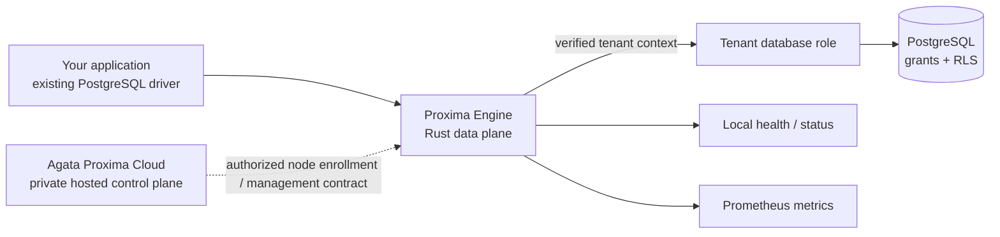

<p align="center">
  
</p>

<h1 align="center">Agata Proxima</h1>
<p align="center"><strong>Security infrastructure for multi-tenant PostgreSQL applications.</strong></p>
<p align="center">The hosted control plane coordinates your organization and registered nodes. Proxima Engine is the open-source data plane that sits between your application and PostgreSQL.</p>

<p align="center">
  <a href="https://github.com/Agata-Proxima/proxima-engine/actions/workflows/ci.yml"></a>
  <a href="LICENSE"></a>
  <a href="https://agataproxima.com"></a>
  
  
</p>

**Start here:** [Quickstart](docs/QUICKSTART.md) · [Architecture](docs/ARCHITECTURE.md) · [Tenant isolation lab](docs/TENANT_ISOLATION.md) · [API & health](docs/API.md) · [Security](docs/SECURITY.md) · [Hosted platform](https://agataproxima.com)

## What is Agata Proxima?

Agata Proxima is designed to make tenant boundaries easier to operate and verify in applications that use PostgreSQL. It has two deliberately separate parts:

- **Proxima Engine — open source:** a Rust PostgreSQL-protocol proxy. It validates signed tenant context when enabled, maps verified tenant IDs to database roles, relays database sessions, and exposes local health/status/Prometheus metrics.
- **Agata Proxima Cloud — hosted, separate product:** the private management experience for authorized organizations and registered Engine nodes. Account, organization, team, plan, billing, and hosted management workflows are not implemented by this repository and are not licensed by the Engine repository's MIT license.

The Engine is not a replacement for PostgreSQL, your application authorization, or database Row-Level Security (RLS). PostgreSQL grants and RLS policies remain essential. Read the [security model](docs/SECURITY.md) before using sensitive workloads.

## See the request path



The dotted line represents the control-plane boundary. This public repository documents the Engine-side contract; it does not expose private Cloud source code or promise that every hosted feature is available in a self-managed installation.

## Run it locally

Requirements: Git and Docker with Compose.

```bash
git clone https://github.com/Agata-Proxima/proxima-engine.git
cd proxima-engine
docker compose -f compose.dev.yaml up --build -d
```

Check the local health and status routes:

```bash
curl -fsS http://127.0.0.1:9090/healthz
curl -fsS http://127.0.0.1:9080/api/status
```

Windows PowerShell equivalent:

```powershell
Invoke-RestMethod http://127.0.0.1:9090/healthz
Invoke-RestMethod http://127.0.0.1:9080/api/status
```

Then run the [full Quickstart](docs/QUICKSTART.md), which performs a real SQL query through the proxy. The Compose profile is a disposable local demo; its example credentials are not for production. The initial connectivity demo does **not** by itself prove tenant isolation.

## A practical path from demo to integration

<details>
<summary><strong>1 — Start the Engine</strong></summary>

Follow [Quickstart](docs/QUICKSTART.md). It starts the Engine and PostgreSQL locally, checks health, inspects status, and sends a query through the proxy.
</details>

<details>
<summary><strong>2 — Understand the trust boundary</strong></summary>

Read [Architecture](docs/ARCHITECTURE.md) and [Security](docs/SECURITY.md). Decide which process is trusted to authorize a user for a tenant and mint a short-lived signed tenant token. Never put the signing key in a browser or mobile application.
</details>

<details>
<summary><strong>3 — Prove tenant separation</strong></summary>

Run [Tenant isolation tutorial](docs/TENANT_ISOLATION.md). It creates two non-superuser roles, applies PostgreSQL RLS, and demonstrates both allowed and denied access. Do not skip negative tests.
</details>

<details>
<summary><strong>4 — Connect your application</strong></summary>

Keep your existing PostgreSQL driver and change its endpoint to the Engine. Copy a server-side example from [Node.js, Python, or Rust integration recipes](docs/INTEGRATIONS.md). Production connections must use correctly verified TLS.
</details>

<details>
<summary><strong>5 — Operate and verify</strong></summary>

Use [API, health, and metrics](docs/API.md), [Operations](docs/OPERATIONS.md), and [Verification & CLI](docs/VERIFICATION.md). A healthy HTTP endpoint is not a substitute for a database query, RLS tests, or review of your production configuration.
</details>

## Documentation

| Guide | What it answers |
|---|---|
| [Quickstart](docs/QUICKSTART.md) | Run a local stack and execute a real SQL query |
| [Architecture](docs/ARCHITECTURE.md) | Components, request lifecycle, trust boundaries |
| [Configuration](docs/CONFIGURATION.md) | Environment variables, defaults, and security-sensitive settings |
| [Tenant isolation](docs/TENANT_ISOLATION.md) | Signed tenant context, PostgreSQL roles, RLS, negative tests |
| [Integrations](docs/INTEGRATIONS.md) | psql, Node.js, Python, and Rust driver examples |
| [API reference](docs/API.md) | Implemented HTTP routes, PostgreSQL endpoint, metrics |
| [Node enrollment](docs/NODE_ENROLLMENT.md) | Engine-side enrollment and persistent node identity |
| [Deployment](docs/DEPLOYMENT.md) | Container deployment and production hardening |
| [Operations](docs/OPERATIONS.md) | Troubleshooting, health checks, logs, recovery |
| [Verification & CLI](docs/VERIFICATION.md) | Tests, attestation verification, break-glass tooling |
| [Security model](docs/SECURITY.md) | Implemented controls, limitations, deployment checklist |
| [Cloud control plane](docs/CLOUD_CONTROL_PLANE.md) | What stays hosted/private and how the parts relate |
| [Plans and billing](docs/BILLING.md) | Hosted plans, usage concepts, upgrade path, billing boundaries |
| [Support](docs/SUPPORT.md) | Where to ask questions and report security issues |
| [Contributing](CONTRIBUTING.md) | Local development and pull-request expectations |
| [Code of Conduct](CODE_OF_CONDUCT.md) | Community standards |
| [Copyright & brand](COPYRIGHT.md) | Source license versus protected brand assets |
| [Security policy](SECURITY.md) | Private vulnerability reporting guidance |

## Hosted Cloud, plans, and support

- **Website and hosted account workflow:** [agataproxima.com](https://agataproxima.com)
- **Plans and billing:** use the current plan and billing information shown through the official hosted account workflow. See [Plans and billing](docs/BILLING.md) for how plan limits and upgrades are described.
- **Support:** [support@agataproxima.com](mailto:support@agataproxima.com). Email availability depends on the domain's mail routing being configured; if email does not work, use the official website.
- **Security vulnerabilities:** do not post exploitable details publicly. Follow [SECURITY.md](SECURITY.md).

## Open-source scope and brand

The Engine source and documentation in this repository are distributed under the [MIT License](LICENSE), subject to the license text. The separate hosted service and its private source code are not included. **The Agata Proxima name, orbit logo, and other brand artwork are reserved brand assets and are not granted for reuse by the Engine source license.** See [COPYRIGHT.md](COPYRIGHT.md) for the scope and limitations of these statements. A source-code license cannot promise that every form of copying is technically preventable; trademark and copyright enforcement depend on applicable law.

## Contribute

Bug reports and feature requests: [GitHub Issues](https://github.com/Agata-Proxima/proxima-engine/issues). Before filing, review [Operations](docs/OPERATIONS.md) and redact secrets, tenant data, and private logs. Please read [CONTRIBUTING.md](CONTRIBUTING.md) and the [Code of Conduct](CODE_OF_CONDUCT.md).

---

<p align="center">Built by Agata Proxima · <a href="https://agataproxima.com">agataproxima.com</a> · <a href="https://github.com/Agata-Proxima">GitHub organization</a></p>


## Hosted product, plans, and support

- Website: [agataproxima.com](https://agataproxima.com)
- Hosted account, organization, team, registered-node, and billing workflows belong to the separate private Cloud application; this repository does not implement those dashboard APIs.
- Support: [support@agataproxima.com](mailto:support@agataproxima.com). Keep this contact only while the mailbox is configured to receive messages; otherwise use the official website.
- Read [Cloud control-plane boundary](docs/CLOUD_CONTROL_PLANE.md), [plans and billing](docs/BILLING.md), and [support](docs/SUPPORT.md).

## Brand and license boundary

The Engine source is licensed under the [MIT License](LICENSE). The separate hosted application is not included. The Agata Proxima name and orbit logo are reserved brand assets and are not granted for reuse by the source-code license; see [COPYRIGHT.md](COPYRIGHT.md). This states the project's intended policy but cannot guarantee copying is technically impossible or replace applicable legal protections.
