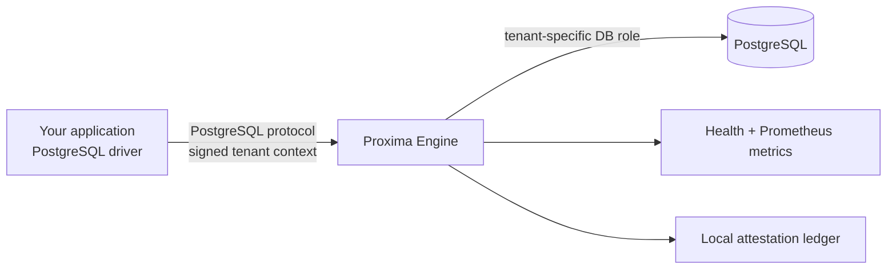

<p align="center">
  
</p>

<h1 align="center">Agata Proxima Engine</h1>

<p align="center"><strong>Security infrastructure for multi-tenant PostgreSQL applications.</strong></p>

<p align="center">
  <a href="https://github.com/Agata-Proxima/proxima-engine/actions/workflows/ci.yml"></a>
  <a href="LICENSE"></a>
  
  
</p>

Agata Proxima is security infrastructure built to sit between a multi-tenant application and PostgreSQL. **Proxima Engine** is its open-source data-plane component: it accepts PostgreSQL connections, validates signed tenant context when enforcement is enabled, routes the session to the matching PostgreSQL role, and relays the PostgreSQL protocol.

Keep your existing PostgreSQL driver. Change the database endpoint to Proxima.

## Start in minutes

**Fastest local run — Docker Compose**

You need Git and Docker Desktop or Docker Engine with Compose.

```bash
git clone https://github.com/Agata-Proxima/proxima-engine.git
cd proxima-engine
docker compose -f compose.dev.yaml up --build -d
```

Optional: copy `.env.example` to `.env` if you want to change the local settings (`Copy-Item .env.example .env` in PowerShell, or `cp .env.example .env` in Bash). The defaults already work without this step.

Check that the engine and its local PostgreSQL database are running:

```bash
curl -fsS http://127.0.0.1:9090/healthz
curl -fsS http://127.0.0.1:9080/api/status
```

**Windows PowerShell:** use `Copy-Item .env.example .env` instead of `cp`, and `Invoke-RestMethod http://127.0.0.1:9090/healthz` / `Invoke-RestMethod http://127.0.0.1:9080/api/status` instead of `curl -fsS`.

Run a real query through the engine:

```bash
docker compose -f compose.dev.yaml exec postgres psql -U proxima -d appdb -c "CREATE TABLE IF NOT EXISTS hello (message text); INSERT INTO hello VALUES ('hello through Proxima');"
psql "host=127.0.0.1 port=6432 dbname=appdb user=proxima password=local-only-change-me sslmode=disable" -c "SELECT * FROM hello;"
```

Expected: the query returns `hello through Proxima`. This local profile demonstrates PostgreSQL connectivity, **not tenant isolation or production security**. The development database password is intentionally local-only. Follow the tenant-isolation guide before using sensitive data.

- [Full quickstart](docs/QUICKSTART.md) · [Tenant isolation tutorial](docs/TENANT_ISOLATION.md) · [Production deployment](docs/DEPLOYMENT.md)

## What it does

- **PostgreSQL wire-protocol proxy** — connect with PostgreSQL-compatible clients and drivers.
- **Signed tenant context** — verify a short-lived HMAC-SHA256 tenant token during connection startup; reject missing or invalid context when enforcement is enabled.
- **Database role routing** — map a verified tenant ID to its PostgreSQL role. PostgreSQL permissions and Row-Level Security (RLS) remain the database enforcement layer.
- **TLS controls** — terminate client TLS and independently verify the PostgreSQL upstream's certificate and hostname.
- **Connection guardrails** — bound connection count, upstream connection time, and TLS handshake time.
- **Operational visibility** — local status page, health checks, and Prometheus metrics.
- **Security evidence** — append-only, hash-linked local attestation records with signing and optional delivery to a compatible receiver.
- **Emergency-access controls** — scoped break-glass tokens with expiry and replay protection.

## How it fits



The Engine is the runtime boundary. PostgreSQL still enforces database permissions and RLS. Your application must still authenticate users and authorize actions. Do not give application traffic an alternate database path that bypasses the Engine and its intended database controls.

## Choose your path

| Goal | Start here |
| --- | --- |
| Run the engine and execute a SQL query | [Quickstart](docs/QUICKSTART.md) |
| Understand the design and trust boundaries | [Architecture](docs/ARCHITECTURE.md) |
| Create tenant roles and test isolation | [Tenant isolation tutorial](docs/TENANT_ISOLATION.md) |
| Register a node with a compatible control plane | [Node enrollment](docs/NODE_ENROLLMENT.md) |
| Configure every environment variable | [Configuration reference](docs/CONFIGURATION.md) |
| Call health/status endpoints or scrape metrics | [API and operations reference](docs/API.md) |
| Enable TLS and harden a deployment | [Security guide](docs/SECURITY.md) |
| Build and deploy a container | [Deployment guide](docs/DEPLOYMENT.md) |
| Verify behavior and run the test suite | [Verification guide](docs/VERIFICATION.md) |
| Read code, contribute, or report a vulnerability | [Contributing](CONTRIBUTING.md) · [Security policy](SECURITY.md) |

## Build from source

Install a stable Rust toolchain, then run:

```bash
cargo test -p proxima-engine
cargo build -p proxima-engine --release
```

Run the resulting binary with your own PostgreSQL server:

```bash
export PROXIMA_UPSTREAM_ADDR=127.0.0.1:5432
export PROXIMA_LISTEN_ADDR=127.0.0.1:6432
cargo run -p proxima-engine
```

Connect your existing client to port `6432`. Configuration is read from process environment variables; see [all options and defaults](docs/CONFIGURATION.md).

## Node identity and enrollment

The Engine can run locally without a hosted account. When you need a registered node identity, it can consume a one-time enrollment token from a compatible Agata Proxima control plane, validate the response, and persist its node identity for subsequent starts.

The Engine repository does **not** contain a node-management API or the hosted management application. Node registration and issuance of one-time tokens must be performed by the control plane you use. The exact copy/paste environment setup, identity file behavior, token lifetime, and troubleshooting are documented in [Node enrollment](docs/NODE_ENROLLMENT.md). Never commit enrollment tokens or node identity files.

## Open source, license, and project boundary

This repository is the open-source **Proxima Engine** implementation. The hosted Agata Proxima service is a separate offering accessed through [agataproxima.com](https://agataproxima.com); its management application is not included in this source tree. You can build, inspect, test, and operate the Engine without copying or exposing that application.

The code and documentation in this repository are distributed under the [MIT License](LICENSE). See [Copyright and trademarks](COPYRIGHT.md) for the scope of that license and the brand boundary. The license for this repository does not make a separate repository or service open source.

## Project status

The CI workflow runs engine tests (including the PostgreSQL-backed integration test) and a release build. Check the live [CI runs](https://github.com/Agata-Proxima/proxima-engine/actions) for the exact commit you plan to use. A passing build is not a third-party security audit or a guarantee that your deployment is correctly configured.

Issues and focused pull requests are welcome. Read [CONTRIBUTING.md](CONTRIBUTING.md) before submitting changes.
