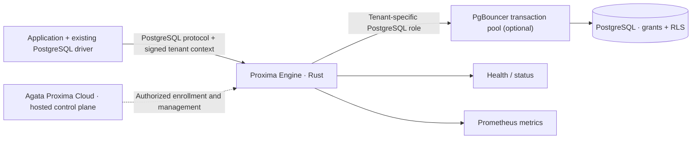

<p align="center">
  
</p>

<h1 align="center">Agata Proxima</h1>
<p align="center"><strong>Security infrastructure for multi-tenant PostgreSQL applications.</strong></p>
<p align="center">Proxima Engine is a Rust PostgreSQL-protocol gateway that verifies signed tenant context and routes each database session to its tenant-specific PostgreSQL role.</p>

<p align="center">
  <a href="https://github.com/Proxima-Engine/proxima-engine/actions/workflows/ci.yml">Continuous integration</a> ·
  <a href="LICENSE">MIT license for covered Engine source</a> ·
  <a href="https://agataproxima.com">Website</a> ·
  <a href="https://discord.gg/xsYSuDMzg">Discord</a> ·
  <a href="https://x.com/Worldtwins25">X</a> ·
  <a href="https://www.linkedin.com/company/agata-proxima/">LinkedIn</a>
</p>

**Start:** [What is Agata Proxima?](#what-is-agata-proxima) · [Launch evaluation](docs/LAUNCH.md) · [Quickstart](docs/QUICKSTART.md) · [Local developer mode](docs/LOCAL_DEVELOPMENT.md) · [Engine CLI](docs/CLI.md) · [Documentation index](docs/README.md)

**Technical guides:** [Architecture](docs/ARCHITECTURE.md) · [Tenant isolation](docs/TENANT_ISOLATION.md) · [Driver integrations](docs/INTEGRATIONS.md) · [API and metrics](docs/API.md) · [Security](docs/SECURITY.md) · [Deployment](docs/DEPLOYMENT.md) · [Verification](docs/VERIFICATION.md)

---

## What is Agata Proxima?

Agata Proxima provides security infrastructure for applications that serve multiple customers from a shared PostgreSQL environment. Its core job is to make tenant identity part of the database connection boundary and route each verified tenant session to a dedicated PostgreSQL role.

The product has two cooperating components:

### Proxima Engine — public, open-source data plane

Proxima Engine is a Rust service that sits between an application's existing PostgreSQL driver and PostgreSQL. It speaks the PostgreSQL wire protocol, so applications keep their existing database drivers and connect to the Engine endpoint.

The Engine provides:

- **Signed tenant-context verification.** Validates tenant tokens using HMAC-SHA256, including token format, tenant identifier, expiry, and signature. Missing or invalid context is rejected when tenant enforcement is enabled.
- **Tenant-to-role routing.** Maps the verified tenant identity to a configured PostgreSQL role and establishes a tenant-bound upstream database session.
- **PostgreSQL-native enforcement.** Works with database roles, grants, and Row-Level Security (RLS), keeping data authorization inside PostgreSQL.
- **Protocol and connection controls.** Handles PostgreSQL startup and authentication negotiation, connection limits, upstream timeouts, and configurable client/upstream TLS.
- **Security operations.** Includes a peer-scoped violation breaker, short-lived break-glass tokens with replay protection, and a local signed attestation ledger.
- **Operational visibility.** Exposes local health and status routes plus Prometheus metrics.
- **Developer tooling.** Includes a Python standard-library CLI, local identity bootstrap, tenant-token generation, integration examples, and repeatable PostgreSQL tests.

### Agata Proxima Cloud — hosted management product

Agata Proxima Cloud is the separate hosted control plane for organization workflows, teams, plans, billing, registered nodes, and hosted management. It coordinates authorized Engine nodes while database traffic remains in the customer environment.

The Cloud application and its private source are separate from this public Engine repository. The MIT license in this repository applies to the material covered by its license; it does not grant access to the hosted application's source code or hosted account features.

## How the request path works



Proxima Engine extends an existing PostgreSQL deployment: it verifies tenant context and selects the database role, while PostgreSQL privileges and RLS policies enforce which rows that role can read or modify. Application authentication and tenant authorization remain in the trusted application backend that issues signed tenant tokens.

**Proxima is designed to complement RLS, not replace it.** Keep your existing PostgreSQL RLS policies, grants, and application authorization. Proxima adds an independent check at the connection boundary: it verifies signed tenant context before a database session is established and binds that session to the tenant's PostgreSQL role. PostgreSQL still makes the final row-access decision. This gives the system two distinct enforcement points rather than asking a new proxy to become your only security control.

## Get started

Requirements: Git and Docker with Compose.

```bash
git clone https://github.com/Proxima-Engine/proxima-engine.git
cd proxima-engine
docker compose -f compose.dev.yaml up --build -d
```

The local profile starts PostgreSQL, PgBouncer in transaction-pooling mode, and Proxima Engine. Check the local listeners:

```bash
curl -fsS http://127.0.0.1:9090/healthz
curl -fsS http://127.0.0.1:9080/api/status
```

Windows PowerShell:

```powershell
Invoke-RestMethod http://127.0.0.1:9090/healthz
Invoke-RestMethod http://127.0.0.1:9080/api/status
```

Then follow the [Quickstart](docs/QUICKSTART.md) to create a table, send a real SQL query through the Engine and PgBouncer, inspect metrics, and stop the local stack. The Compose profile uses disposable local credentials and synthetic data.

## Verify tenant isolation

The repository includes PostgreSQL-backed tenant tests and a dedicated [PgBouncer tenant-pool integration test](scripts/test-pgbouncer-pooling.sh), which is run by GitHub Actions.

The verification path covers:

1. Tenant A authenticates and reads only Tenant A's row.
2. Tenant B authenticates and reads only Tenant B's row.
3. Cross-tenant reads return zero visible rows.
4. Cross-tenant writes are rejected by PostgreSQL RLS.
5. Missing or invalid signed tenant context is rejected when enforcement is enabled.
6. Five sequential connections per tenant reuse that tenant role's backend PID, while the two tenant roles use separate backend PIDs through PgBouncer transaction pooling.

See [Tenant isolation](docs/TENANT_ISOLATION.md), [Verification](docs/VERIFICATION.md), and the [recorded PgBouncer transaction-pooling evidence](evidence/pgbouncer-transaction-pooling.txt).

## Documentation

| Guide | Purpose |
|---|---|
| [Quickstart](docs/QUICKSTART.md) | Start the local stack and query PostgreSQL through the Engine |
| [Local developer mode](docs/LOCAL_DEVELOPMENT.md) | Generate local node identity and signed tenant test tokens |
| [Engine CLI](docs/CLI.md) | Bootstrap, token generation, diagnostics, and local status commands |
| [Architecture](docs/ARCHITECTURE.md) | Request lifecycle, tenant context, source map, and control-plane boundary |
| [Configuration](docs/CONFIGURATION.md) | Environment variables, defaults, and validation |
| [Tenant isolation](docs/TENANT_ISOLATION.md) | PostgreSQL roles, RLS policies, signed context, and test results |
| [Driver integrations](docs/INTEGRATIONS.md) | psql, Node.js, Python, and Rust connection examples |
| [API reference](docs/API.md) | PostgreSQL endpoint, health/status routes, and Prometheus metrics |
| [Node enrollment](docs/NODE_ENROLLMENT.md) | Engine-side node identity and enrollment contract |
| [Deployment](docs/DEPLOYMENT.md) | Container build, TLS, networking, persistence, and deployment configuration |
| [Operations](docs/OPERATIONS.md) | Health checks, logs, monitoring, recovery, and troubleshooting |
| [Verification](docs/VERIFICATION.md) | Rust tests, PostgreSQL integration tests, CI, and evidence verification |
| [Security model](docs/SECURITY.md) | Implemented controls and the configuration required to operate them |
| [Developer security walkthrough](docs/DEVELOPER_SECURITY_DEMO.md) | Reproduce positive and negative tenant-access scenarios |
| [Cloud control plane](docs/CLOUD_CONTROL_PLANE.md) | Hosted product and self-managed Engine responsibilities |
| [Plans and billing](docs/BILLING.md) | Hosted plan and checkout information |
| [Support](docs/SUPPORT.md) | Technical support, issue reporting, and contact routes |
| [Contributing](CONTRIBUTING.md) | Development setup and pull-request process |
| [Security policy](SECURITY.md) | Private vulnerability reporting |
| [Code of Conduct](CODE_OF_CONDUCT.md) | Community participation standards |
| [Copyright and brand](COPYRIGHT.md) | Source-license and brand-asset boundaries |
| [Open-source scope](docs/OPEN_SOURCE_SCOPE.md) | MIT-licensed source, self-managed use, and support boundaries |

## Hosted product and contact

- **Website and hosted account:** [agataproxima.com](https://agataproxima.com)
- **Plans and billing:** [Hosted plan information](docs/BILLING.md)
- **Support:** [support@agataproxima.com](mailto:support@agataproxima.com)
- **Security reports:** [Private vulnerability reporting instructions](SECURITY.md)
- **Community:** [Discord](https://discord.gg/xsYSuDMzg)

## Open-source scope

The Proxima Engine source and covered documentation are distributed under the [MIT License](LICENSE). The hosted Cloud application, hosted account workflows, and private management source are separate products and are not included in this repository's license. The Agata Proxima name, orbit logo, and designated brand artwork are reserved brand assets; see [Copyright and brand](COPYRIGHT.md).

## Contribute

Use [GitHub Issues](https://github.com/Proxima-Engine/proxima-engine/issues) for reproducible Engine bugs and feature requests. Read [Contributing](CONTRIBUTING.md) before submitting a pull request. For vulnerabilities, use the private reporting process in [SECURITY.md](SECURITY.md).

<p align="center">Built by Agata Proxima · <a href="https://agataproxima.com">agataproxima.com</a> · <a href="https://github.com/Agata-Proxima">GitHub organization</a></p>
