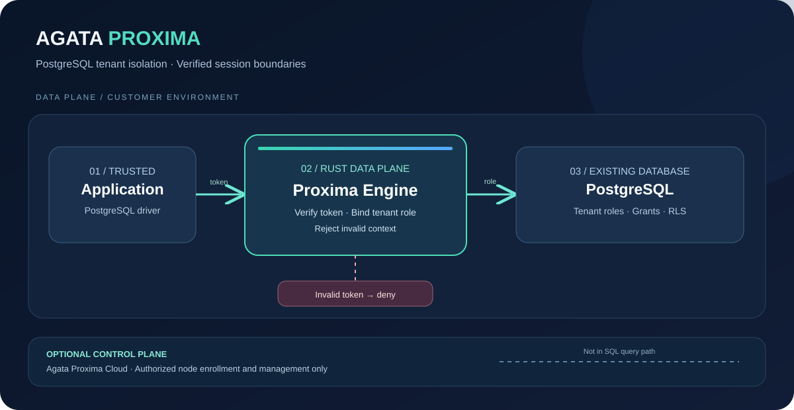
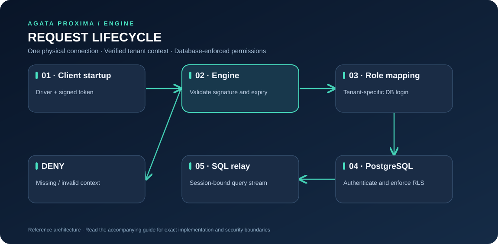
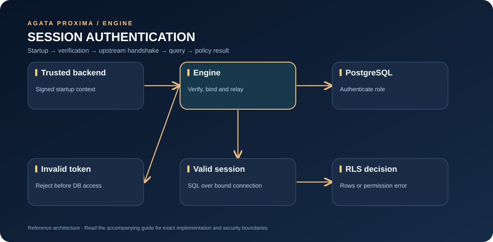
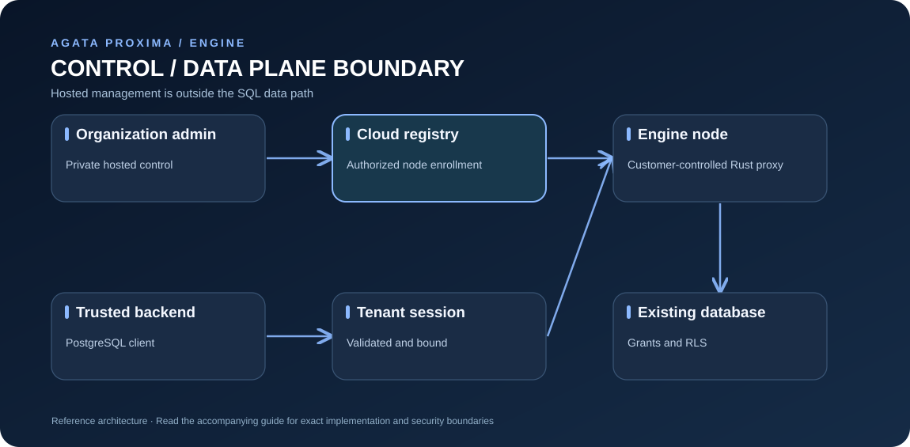

# Architecture

Agata Proxima is security infrastructure for multi-tenant applications. Proxima Engine is the public Rust data-plane process in this repository. It sits between a PostgreSQL client and an existing PostgreSQL server; it does not replace the database, an ORM, or application-level authorization.

## Visual architecture



[Open full-size SVG](assets/proxima-architecture.svg). This custom vector diagram works independently of Mermaid rendering.

## Request path



[Open full-size diagram](assets/request-path.svg)

A normal connection proceeds through these stages:

1. Accept a client TCP connection and apply the configured connection limit.
2. Negotiate PostgreSQL startup and TLS according to the listener configuration.
3. If tenant enforcement is configured, extract the tenant token from startup parameters or the PostgreSQL `options` field.
4. Verify the token version, tenant identifier, expiry, and HMAC-SHA256 signature. Reject invalid or missing context.
5. Normalize the tenant identifier and rewrite the upstream PostgreSQL username to `<role-prefix><tenant-id>`.
6. Connect to the configured PostgreSQL upstream and broker its authentication handshake.
7. Relay PostgreSQL messages for the lifetime of that physical session, then record connection/query metrics.

The Engine does not pool and retarget one physical PostgreSQL session between tenants. Each accepted client connection has its own upstream session.

## Tenant verification and session lifecycle



[Open full-size diagram](assets/session-sequence.svg)

The diagram summarizes the intended protocol flow; PostgreSQL authentication can involve multiple messages, and PostgreSQL grants and RLS remain responsible for database authorization.

## Tenant token contract

The standard token format is:

```text
v1.<tenant_id>.<expires_at_unix_seconds>.<hex_hmac_sha256>
```

The signature covers the exact UTF-8 payload `v1.<tenant_id>.<expires_at_unix_seconds>`. The signing secret must be at least 32 bytes. Tenant IDs are restricted to ASCII letters, numbers, hyphens, and underscores. Hyphens become underscores when deriving the PostgreSQL role name; the final role must fit PostgreSQL's 63-byte identifier limit.

For libpq-compatible clients, send the token in startup options as `-c proxima_tenant_token=<signed-token>`. The Engine removes the private option before forwarding startup. The signing key must stay on trusted servers; a tenant ID supplied by a client is not proof of authorization.

## PostgreSQL remains the database security layer

Proxima routes a verified session to a tenant-specific PostgreSQL role. PostgreSQL grants, role attributes, schemas, and Row-Level Security policies still decide what that role can access. Use ordinary non-superuser roles, avoid `BYPASSRLS`, consider `FORCE ROW LEVEL SECURITY`, and remove alternate privileged paths that could bypass the Engine.

Proxima does not automatically infer your application's authorization rules or make a poorly configured database safe. Follow the [runnable tenant isolation tutorial](TENANT_ISOLATION.md).

## TLS boundary

Client TLS termination and upstream TLS are independent:

```text
Application --client TLS--> Proxima --verified upstream TLS--> PostgreSQL
```

Client-side TLS requires a certificate and key; `PROXIMA_TLS_REQUIRE_CLIENT=true` rejects plaintext connections. Upstream `verify-full` mode requires a CA file and expected server name. The Engine does not claim that TLS is enforced when the relevant settings are absent.

## Modules and source map

| Source | Responsibility |
| --- | --- |
| `src/main.rs` | Startup, listeners, connection lifecycle, optional node enrollment and evidence delivery |
| `src/config.rs` | Environment parsing and validation |
| `src/protocol.rs` | PostgreSQL startup and message parsing |
| `src/session.rs` | Startup, tenant verification hook, upstream role routing, authentication handshake |
| `src/tenant.rs` | HMAC tenant tokens and break-glass token validation/replay protection |
| `src/policy.rs` | In-memory tenant session binding |
| `src/tls.rs` | Client and upstream TLS |
| `src/security_breaker.rs` | Peer-scoped violation threshold and cooldown |
| `src/break_glass.rs` | Emergency-access event handling |
| `src/attestation.rs` | Hash-linked local evidence ledger and verification |
| `src/metrics.rs` | Health listener and Prometheus metrics |
| `src/dashboard.rs`, `dashboard/index.html` | Embedded local status page and logo |
| `src/bin/` | Attestation verification and break-glass token CLI tools |
| `tests/postgres_integration.rs` | Real PostgreSQL proxy and RLS integration test |

## Control-plane boundary

The Engine can run standalone. Optional node enrollment and evidence delivery integrate with a compatible control plane, but this repository does not serve the hosted management API or application. See [Node enrollment](NODE_ENROLLMENT.md) for the exact engine-side contract.


## Deployment shapes

### Local development

Use [Quickstart](QUICKSTART.md) and the repository's Compose profile with disposable data. Its connectivity test is intentionally separate from the tenant isolation lab.

### Self-managed environment

Run the Engine close to the PostgreSQL service it protects. Restrict network access to the proxy, status listener, and metrics listener independently. Keep credentials in a secret manager or protected runtime environment and use verified TLS wherever traffic crosses a trust boundary.

### Hosted Cloud plus customer Engine

The private hosted Cloud and the public Engine have separate responsibilities. The Cloud may coordinate authorized account and node workflows; the Engine handles database-facing traffic in the customer's environment. Enrollment does not replace application authorization, PostgreSQL grants, RLS, or local operational monitoring. The public repository documents only the Engine-side contract.

## Control plane and data plane separation



[Open full-size diagram](assets/control-boundary.svg)

The hosted control plane is not in the SQL query path. The Engine can operate without a hosted account in documented local development mode.

## Failure boundaries

- **Application authorization failure:** the backend must not mint tenant context for an unauthorized user.
- **Token validation failure:** reject the request rather than silently falling back to an unscoped tenant.
- **Database permission failure:** verify the selected role, grants, and RLS policy; do not solve it by granting superuser access.
- **Control-plane unavailable:** follow the configured Engine behavior and deployment policy; do not assume a remote dashboard can safely substitute for local database enforcement.
- **Metrics/status unavailable:** investigate observability separately from SQL correctness; a failed metrics listener does not by itself establish whether data access is safe.

See [Security](SECURITY.md), [Tenant isolation](TENANT_ISOLATION.md), and [Operations](OPERATIONS.md).