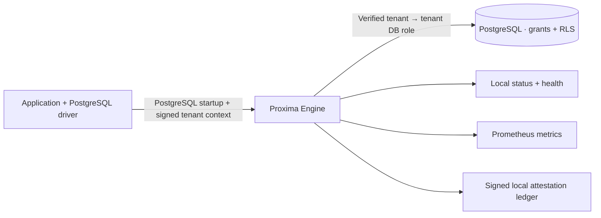
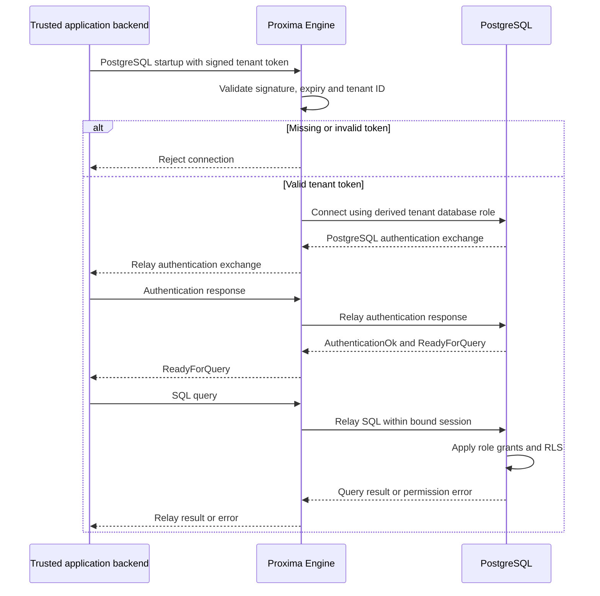
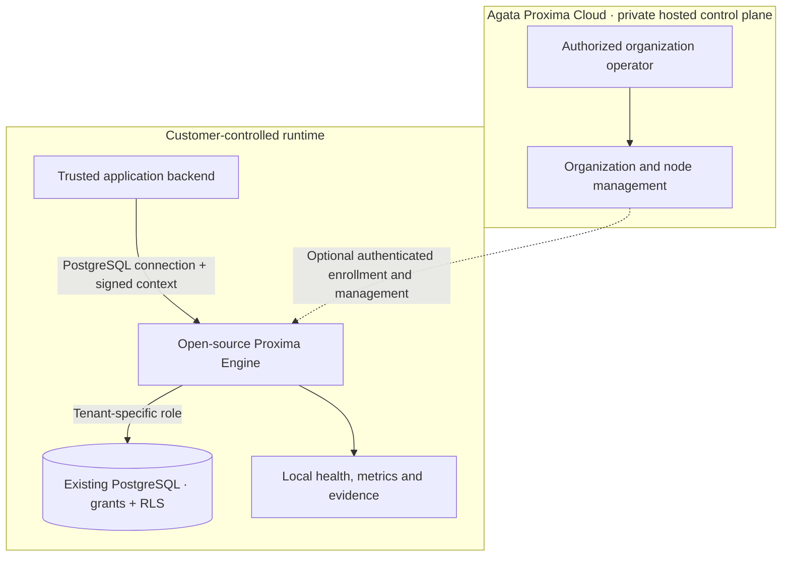

# Proxima Engine architecture

Agata Proxima provides security infrastructure for multi-tenant PostgreSQL applications. Proxima Engine is its public Rust data plane: a PostgreSQL wire-protocol gateway that verifies signed tenant context and routes each accepted connection to a tenant-specific PostgreSQL role.

Applications retain their existing PostgreSQL drivers. PostgreSQL remains the database and applies the grants and Row-Level Security (RLS) policies assigned to each tenant role.

## Request path



A connection follows this sequence:

1. Accept the client TCP connection and apply the configured connection limit.
2. Negotiate PostgreSQL startup and client TLS according to listener configuration.
3. When tenant enforcement is enabled, read the signed tenant token from startup parameters or the PostgreSQL `options` field.
4. Validate the token version, tenant identifier, expiry, and HMAC-SHA256 signature. Reject missing or invalid context.
5. Normalize the verified tenant identifier and derive the upstream PostgreSQL username from the configured role prefix.
6. Connect to PostgreSQL using the tenant-specific role and relay the database authentication exchange.
7. Keep the client connection bound to its upstream PostgreSQL session for the lifetime of that connection.
8. Relay PostgreSQL protocol messages and update connection/query metrics.

The Engine does not multiplex different tenant identities over one upstream session. Tenant identity is selected at connection startup and the upstream session remains bound to the resulting database role.

## Tenant verification and session lifecycle



## Tenant token contract

The token format is:

```text
v1.<tenant_id>.<expires_at_unix_seconds>.<hex_hmac_sha256>
```

The signature covers the exact UTF-8 payload `v1.<tenant_id>.<expires_at_unix_seconds>`. The signing secret must contain at least 32 bytes. Tenant IDs accept ASCII letters, numbers, hyphens, and underscores. Hyphens are converted to underscores when deriving the PostgreSQL role name; the resulting role must fit PostgreSQL's 63-byte identifier limit.

For libpq-compatible clients, pass the token in startup options as `-c proxima_tenant_token=<signed-token>`. The Engine removes this private option before forwarding startup to PostgreSQL. The signing key belongs on a trusted server; a tenant ID supplied by an untrusted client is not proof of authorization.

## PostgreSQL authorization layer

Proxima maps a verified tenant session to a tenant-specific PostgreSQL role. PostgreSQL grants, role attributes, schemas, and RLS policies determine the data that role can access.

Use ordinary non-superuser tenant roles, avoid `BYPASSRLS`, apply `FORCE ROW LEVEL SECURITY` where appropriate, and remove alternate privileged paths that could bypass the intended boundary. The [Tenant isolation guide](TENANT_ISOLATION.md) provides runnable SQL and positive/negative tests.

## Connection pooling

The Engine binds each accepted client connection to its own upstream PostgreSQL session. When PgBouncer transaction pooling is placed downstream, PostgreSQL's tenant-specific role becomes part of the PgBouncer pool identity.

The recorded [PgBouncer evidence](../evidence/pgbouncer-transaction-pooling.txt) shows backend PID reuse within each tenant role and separate observed backend PIDs for Tenant A and Tenant B. This is role-separated pooling: backend reuse occurs within each tenant role's pool.

## TLS boundary

Client TLS termination and upstream TLS are configured independently:

```text
Application --client TLS--> Proxima --verified upstream TLS--> PostgreSQL
```

Client-side TLS uses a certificate and key; `PROXIMA_TLS_REQUIRE_CLIENT=true` rejects plaintext client connections. Upstream `verify-full` mode uses a trusted CA file and expected server name. See [Configuration](CONFIGURATION.md) and [Deployment](DEPLOYMENT.md).

## Modules and source map

| Source | Responsibility |
|---|---|
| `src/main.rs` | Startup, listeners, connection lifecycle, optional node enrollment and evidence delivery |
| `src/config.rs` | Environment parsing and validation |
| `src/protocol.rs` | PostgreSQL startup and message parsing |
| `src/session.rs` | Startup, tenant verification, upstream role routing, authentication handshake |
| `src/tenant.rs` | HMAC tenant tokens and break-glass token validation/replay protection |
| `src/policy.rs` | In-memory tenant session binding |
| `src/tls.rs` | Client and upstream TLS |
| `src/security_breaker.rs` | Peer-scoped violation threshold and cooldown |
| `src/break_glass.rs` | Emergency-access event handling |
| `src/attestation.rs` | Hash-linked local evidence ledger and verification |
| `src/metrics.rs` | Health listener and Prometheus metrics |
| `src/dashboard.rs`, `dashboard/index.html` | Embedded local status page and logo |
| `src/bin/` | Attestation verification and break-glass token CLI tools |
| `tests/postgres_integration.rs` | Real PostgreSQL proxy and RLS integration test |

## Control-plane and data-plane separation



The hosted control plane coordinates authorized organization and node workflows. It is outside the SQL query path. Proxima Engine can also run independently in local developer mode. The public repository documents the Engine-side enrollment and evidence contracts; the hosted management application is a separate product.

## Deployment shapes

- **Local development:** use [Quickstart](QUICKSTART.md) and the disposable Compose profile.
- **Self-managed environment:** run the Engine close to PostgreSQL, restrict each listener independently, store credentials in protected runtime configuration, and use verified TLS across trust boundaries.
- **Hosted Cloud with customer Engine:** use Cloud for authorized organization and node workflows; keep database traffic in the customer environment and enforce tenant data access with PostgreSQL roles and RLS.

## Failure handling

- **Application authorization:** the trusted backend authorizes tenant membership before issuing signed context.
- **Token validation:** missing, expired, or invalid tokens are rejected when enforcement is enabled.
- **Database permissions:** PostgreSQL grants and RLS decide the selected role's access.
- **Control-plane connectivity:** local SQL enforcement remains in the Engine and PostgreSQL; enrollment and evidence delivery are separate outbound workflows.
- **Observability:** health, status, and metrics report process and operational state; database query tests verify the SQL path.

See [Security](SECURITY.md), [Tenant isolation](TENANT_ISOLATION.md), and [Operations](OPERATIONS.md).
