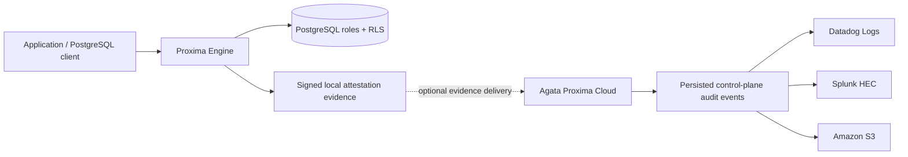

# Audit evidence and external exports

This guide separates the Engine's local security evidence from hosted audit-log exports. They are related, but they are not the same pipeline.

## Architecture

- **Engine evidence:** the Engine can maintain a signed, hash-linked local attestation ledger and provide a verifier. Configure and verify it using [Verification and CLI](VERIFICATION.md).
- **Hosted audit exports:** Datadog, Splunk HEC, and Amazon S3 exports operate on persisted control-plane audit events. They are a hosted Cloud capability, not a direct Engine-to-provider export feature.
- **Boundary:** optional Engine evidence delivery to a compatible control plane does not mean that the Engine itself exports its local ledger to those providers, and it does not make the hosted control plane part of a self-managed Engine installation.

## Related guides

- [Architecture and trust boundaries](ARCHITECTURE.md)
- [Node identity and enrollment](NODE_ENROLLMENT.md)
- [Verification and CLI tools](VERIFICATION.md)
- [Security model and limitations](SECURITY.md)
- [Hosted Cloud boundary](CLOUD_CONTROL_PLANE.md)
- [Hosted product](https://agataproxima.com)

## Operational checks

1. Verify the Engine's local ledger with the documented verifier and the matching signing configuration.
2. If using hosted Cloud, separately verify that the control plane has persisted the relevant audit event.
3. For a configured external destination, check the destination's delivery history and confirm receipt in the provider. A configured destination or green CI run alone does not prove external delivery.
4. Never copy signing keys, database credentials, provider tokens, or customer audit records into public issues or documentation.

This page documents the current integration boundary; it does not claim that external audit exports run inside the public Engine.
