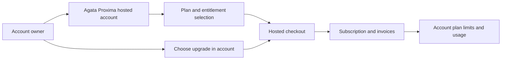

# Hosted plans and billing

This page describes the commercial boundary, not a price quote or promise of particular entitlements.

## Where billing happens

Use the official hosted account at [agataproxima.com](https://agataproxima.com) to review the plans available to your account, compare included limits, select an upgrade, and review checkout, subscription, and invoice status. The public Engine does not process payments or grant plan entitlements.

## Where billing happens

Plan selection, checkout, subscription status, invoices, and upgrades belong to the separate Agata Proxima Cloud product. The public Engine repository does not implement checkout or grant hosted plan entitlements.

Start at [agataproxima.com](https://agataproxima.com) and use the plan and billing information displayed for your account. Current checkout and account screens are the source of truth for price, currency, availability, limits, and overage terms. Do not infer exact limits from plan names.

## Plan families

| Plan | What to check |
|---|---|
| Free | Features and usage actually enabled for evaluation |
| Starter | Included resources, seats, and usage limits |
| Growth | Higher included usage and any advanced controls |
| Scale | Capacity, security features, and support terms |
| Enterprise | Custom capacity, support, compliance, and contract terms confirmed directly |

Review the live plan comparison for the exact included tenants, environments, integrations, verifications, seats, usage reset, and overage rules. These values are deliberately not invented in this public Engine repository.

## Before upgrading

1. Confirm plan, billing interval, currency, taxes, and renewal date.
2. Review included limits and what counts as usage.
3. Check overage, cancellation, and payment terms at checkout.
4. Confirm which features require a higher tier.
5. After checkout, verify the plan and feature access in your account; a redirect alone does not prove entitlements were applied.

## Separation from Engine

Running the open-source Engine does not create a subscription. Running it also does not bypass Cloud plan checks or grant private hosted features. See [Cloud control-plane boundary](CLOUD_CONTROL_PLANE.md).

## Support

Use [support@agataproxima.com](mailto:support@agataproxima.com) only while the mailbox is active and monitored, or visit [agataproxima.com](https://agataproxima.com). Never email payment-card data, API secrets, tenant records, or passwords.
