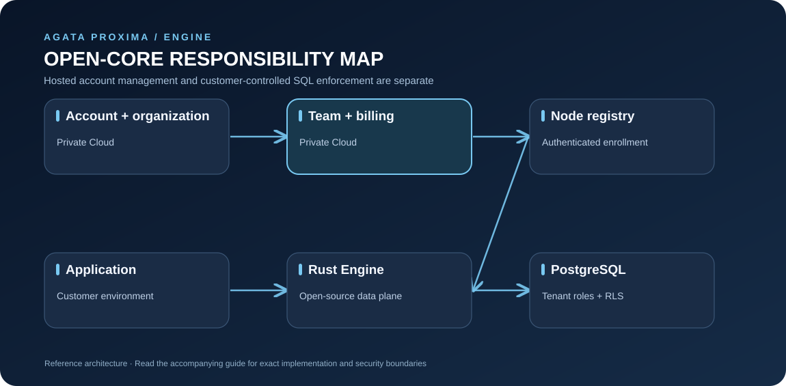

# Agata Proxima Cloud and Proxima Engine

This guide describes the public integration boundary without exposing private source code, internal endpoints, credentials, or customer data.

## Two cooperating products

[Open full-size diagram](assets/cloud-boundary.svg)

The diagram is conceptual. The hosted Cloud product and this repository have different source and access boundaries.

## Hosted workflow

1. Start at [agataproxima.com](https://agataproxima.com).
2. Sign in or create an account using the currently available hosted workflow.
3. Select or create an organization your account is authorized to manage.
4. Follow the product's current plan and node-registration instructions.
5. Configure the Engine using [Node enrollment](NODE_ENROLLMENT.md).
6. Verify health, database connectivity, tenant isolation, and operational alerts before sensitive workloads.

Screens and available actions depend on the deployed product and account permissions. This guide intentionally does not invent dashboard routes or API endpoints.

## Self-managed Engine

You can inspect, build, and run the Engine without access to private Cloud source. Self-managed deployment does not automatically create a hosted account, organization, billing relationship, or Cloud-managed node. Start with [Quickstart](QUICKSTART.md), then [Configuration](CONFIGURATION.md) and [Deployment](DEPLOYMENT.md).

## Trust boundary

- A dashboard login does not make arbitrary database requests safe.
- The trusted backend must authorize users and tenants before issuing signed tenant context.
- Keep signing keys and database credentials out of browsers, mobile clients, public repositories, and logs.
- PostgreSQL grants and RLS policies must enforce data access even if application code is misconfigured.
- Keep status and metrics listeners private unless an authenticated monitoring layer protects them.

## What this repository does not promise

This repository does not expose Cloud source, promise an undocumented REST API for creating hosted users or nodes, or guarantee plan entitlements. Use the hosted website for current account, plan, and billing information.
