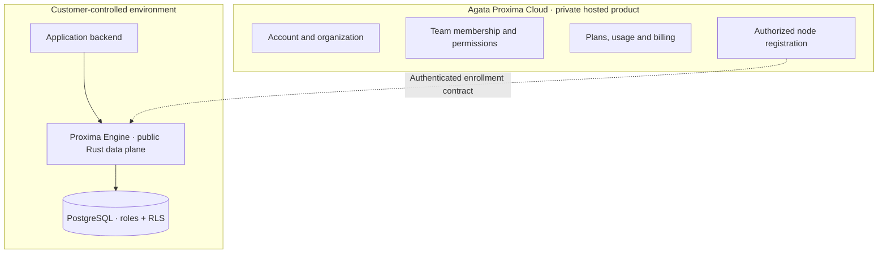

# Agata Proxima Cloud and Proxima Engine

Agata Proxima consists of a hosted management product and a public, open-source PostgreSQL data plane. They cooperate through an authenticated node-enrollment and evidence-delivery contract while retaining separate responsibilities and source boundaries.

## Two cooperating products

## Hosted workflow

1. Open [agataproxima.com](https://agataproxima.com).
2. Sign in or create an account using the available hosted workflow.
3. Select or create an organization your account is authorized to manage.
4. Review the plan and node-registration options available to that organization.
5. Configure the Engine using the [Node enrollment guide](NODE_ENROLLMENT.md).
6. Verify database connectivity, tenant isolation, health monitoring, and operational alerts in the target environment.

The hosted account interface is the source of truth for currently available screens, permissions, plans, and account actions.

## Self-managed Engine

The public Engine can be inspected, built, and run independently of the hosted Cloud application. Local development includes node-identity generation and signed test-token tools; see [Local developer mode](LOCAL_DEVELOPMENT.md).

A self-managed Engine uses local credentials and PostgreSQL configuration. A hosted registered-node identity is issued by a compatible control plane through the enrollment contract documented in [Node enrollment](NODE_ENROLLMENT.md).

## Trust and responsibility boundaries

- The trusted application backend authenticates users and authorizes tenant membership before issuing signed tenant context.
- The Engine verifies signed context and routes the session to a tenant-specific PostgreSQL role.
- PostgreSQL grants and RLS policies enforce database access.
- Cloud manages hosted account, organization, team, plan, billing, and registered-node workflows.
- Keep signing keys, database credentials, node identity files, and enrollment tokens in protected runtime storage.
- Keep local status and metrics listeners on loopback or behind a separately authenticated monitoring layer.

## Hosted API and source boundary

The public repository documents the Engine-side enrollment request and identity-persistence contract. Hosted management endpoints, account workflows, and the Cloud source remain part of the separate private hosted product. Use the hosted website for current account, plan, and node-management instructions.
