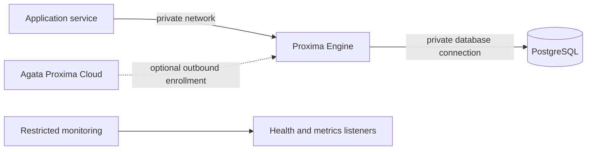

# Deploy Proxima Engine

This guide builds the Engine container and runs it beside an existing PostgreSQL service. The Engine is the database-facing data plane; hosted organization and billing workflows remain in Agata Proxima Cloud.

## Deployment topology



Keep PostgreSQL, the Engine listener, and unauthenticated status/metrics listeners on private networks. Apply network policy, TLS, secret management, persistent storage, and backups for the environment.

## 1. Build the image

From the repository root:

```bash
docker build -t agata-proxima-engine:local .
```

The multi-stage image builds the Rust Engine, runs it as a non-root user, and embeds the local status page and logo in the binary.

## 2. Run against PostgreSQL

The Engine must be able to reach its upstream database from inside the container. Replace the sample address with a DNS name or IP reachable from the container:

```bash
docker run --rm --name proxima-engine \
  -p 127.0.0.1:6432:6432 \
  -e PROXIMA_LISTEN_ADDR=0.0.0.0:6432 \
  -e PROXIMA_UPSTREAM_ADDR=host.docker.internal:5432 \
  -e PROXIMA_DASHBOARD_ENABLED=false \
  -e PROXIMA_METRICS_LISTEN_ADDR=127.0.0.1:9090 \
  -v proxima-engine-data:/var/lib/proxima \
  agata-proxima-engine:local
```

On Linux, enable `host.docker.internal` with `--add-host=host.docker.internal:host-gateway` when required. For deployed environments, prefer a private service network and an explicit upstream hostname.

If Prometheus needs to scrape metrics, bind the metrics listener to the container interface and publish it only on a private monitoring network. The embedded status page has no built-in authentication; protect it with network policy or an authenticated access layer.

## 3. Enable tenant-context enforcement

Set `PROXIMA_TENANT_SIGNING_KEY` to a strong secret of at least 32 bytes. Create the matching PostgreSQL tenant roles and RLS policies using the [Tenant isolation guide](TENANT_ISOLATION.md).

When the signing key is configured, the Engine requires a valid signed tenant token during PostgreSQL startup. Missing, expired, malformed, or incorrectly signed tokens are rejected.

The trusted application backend signs tenant tokens only after authenticating the user and authorizing tenant membership. Keep the signing key out of browsers, mobile clients, public repositories, and logs.

## 4. Configure TLS on both connections

Client-facing TLS and upstream TLS are independent. Example environment values:

```bash
PROXIMA_TLS_CERT_FILE=/run/secrets/proxima-server.crt
PROXIMA_TLS_KEY_FILE=/run/secrets/proxima-server.key
PROXIMA_TLS_REQUIRE_CLIENT=true
PROXIMA_UPSTREAM_TLS_MODE=verify-full
PROXIMA_UPSTREAM_TLS_CA_FILE=/run/secrets/postgres-ca.crt
PROXIMA_UPSTREAM_TLS_SERVER_NAME=postgres.internal.example
```

Mount certificates read-only and ensure the Engine process can read them. Upstream `verify-full` uses the trusted CA and expected server name. Include certificate rotation and invalid-certificate cases in deployment verification.

## 5. Persist Engine state and enroll nodes

Mount a persistent, access-restricted volume at `/var/lib/proxima`. The container stores node identity, the local attestation ledger, and break-glass replay records there. Back up this state according to your recovery requirements.

For registration with a compatible control plane, configure `PROXIMA_NODE_ID`, `PROXIMA_NODE_ENROLLMENT_URL`, and `PROXIMA_NODE_ENROLLMENT_TOKEN` for the first enrollment. The one-time token is consumed during bootstrap; the saved identity is used on subsequent restarts. See [Node enrollment](NODE_ENROLLMENT.md).

## Deployment acceptance checklist

- [ ] Pin the reviewed source revision and container image digest.
- [ ] Replace every sample password and secret; store runtime credentials outside the image and repository.
- [ ] Restrict PostgreSQL, proxy, status, and metrics listeners to their intended callers.
- [ ] Enable verified TLS according to the network trust model.
- [ ] Enable signed tenant-context enforcement and verify its active status.
- [ ] Configure least-privilege PostgreSQL tenant roles and RLS policies.
- [ ] Run positive and negative tenant-access tests with at least two synthetic tenants.
- [ ] Keep signing keys and identity files in protected secret storage or restricted persistent volumes.
- [ ] Test restart, upstream outage, token expiry, certificate expiry, backup/restore, and rollback.
- [ ] Configure monitoring, alerts, log redaction, and an incident owner.
- [ ] Run [Verification](VERIFICATION.md) against the exact image and environment.

The checklist records runtime configuration and test results. Mark an item complete after verifying the effective deployment, not solely because an example setting appears in a file.

## Operating boundary

The Engine handles PostgreSQL protocol traffic, tenant-context verification, role routing, and local operational endpoints. Database provisioning, secret distribution, orchestration, ingress, load balancing, monitoring infrastructure, backups, and incident response are configured by the deployment operator or the surrounding platform.

For hosted account, organization, plan, and billing workflows, see [Cloud control plane](CLOUD_CONTROL_PLANE.md).
