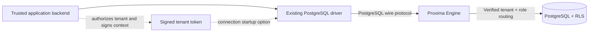

# PostgreSQL driver integration recipes

Proxima Engine speaks the PostgreSQL wire protocol. Keep the driver already used by your application and point its host and port at the Engine. When tenant enforcement is enabled, the trusted application backend supplies a signed tenant token during PostgreSQL connection startup.

The examples use local addresses and `sslmode=disable` for development. Configure verified TLS for deployed connections.

## Connection flow



Keep tenant-token signing keys on trusted server-side components. Never generate tenant tokens in browser code or ship signing secrets to clients.

## psql

```bash
PGPASSWORD="$TENANT_DATABASE_PASSWORD" \
PGOPTIONS="-c proxima_tenant_token=$TENANT_TOKEN" \
psql "host=127.0.0.1 port=6432 dbname=appdb user=proxima sslmode=disable" \
  -c "SELECT current_user, current_database();"
```

The client username is the proxy login name. The Engine derives the upstream PostgreSQL username from the signed tenant ID. The supplied password must authenticate as that tenant's upstream database role.

## Node.js — node-postgres (`pg`)

Install the driver:

```bash
npm install pg
```

Server-side connection:

```javascript
import pg from "pg";

const { Client } = pg;
const tenantToken = process.env.PROXIMA_TENANT_TOKEN;
if (!tenantToken) throw new Error("PROXIMA_TENANT_TOKEN is required");

const client = new Client({
  host: process.env.PROXIMA_HOST ?? "127.0.0.1",
  port: Number(process.env.PROXIMA_PORT ?? 6432),
  database: process.env.PG_DATABASE ?? "appdb",
  user: process.env.PROXIMA_LOGIN ?? "proxima",
  password: process.env.TENANT_DATABASE_PASSWORD,
  options: `-c proxima_tenant_token=${tenantToken}`,
  // Local development only. Configure verified TLS for deployed connections.
  ssl: false,
});

await client.connect();
try {
  const result = await client.query("SELECT current_user, current_database()");
  console.log(result.rows[0]);
} finally {
  await client.end();
}
```

Generate the token only after the trusted backend has checked the signed-in user's tenant access.

## Python — Psycopg 3

Install Psycopg:

```bash
python -m pip install "psycopg[binary]"
```

```python
import os
import psycopg

tenant_token = os.environ["PROXIMA_TENANT_TOKEN"]
with psycopg.connect(
    host=os.getenv("PROXIMA_HOST", "127.0.0.1"),
    port=int(os.getenv("PROXIMA_PORT", "6432")),
    dbname=os.getenv("PG_DATABASE", "appdb"),
    user=os.getenv("PROXIMA_LOGIN", "proxima"),
    password=os.environ["TENANT_DATABASE_PASSWORD"],
    options=f"-c proxima_tenant_token={tenant_token}",
    sslmode="disable",  # local development only
) as conn:
    print(conn.execute("SELECT current_user, current_database()").fetchone())
```

## Rust — tokio-postgres

Add `tokio-postgres` and `tokio` to your application dependencies. This example uses `NoTls` for local development:

```rust
use tokio_postgres::{config::SslMode, NoTls};

#[tokio::main]
async fn main() -> Result<(), Box<dyn std::error::Error>> {
    let tenant_database_password = std::env::var("TENANT_DATABASE_PASSWORD")?;
    let tenant_token = std::env::var("PROXIMA_TENANT_TOKEN")?;

    let mut config = tokio_postgres::Config::new();
    config
        .host("127.0.0.1")
        .port(6432)
        .dbname("appdb")
        .user("proxima")
        .password(tenant_database_password)
        .ssl_mode(SslMode::Disable)
        .options(format!("-c proxima_tenant_token={tenant_token}"));

    let (client, connection) = config.connect(NoTls).await?;
    tokio::spawn(async move {
        if let Err(error) = connection.await {
            eprintln!("PostgreSQL connection error: {error}");
        }
    });
    let row = client.query_one("SELECT current_database()", &[]).await?;
    let database: String = row.get(0);
    println!("{database}");
    Ok(())
}
```

## Connection pooling

Tenant identity is selected when the physical PostgreSQL connection starts. Configure application pools so each pool uses one tenant identity and its corresponding database-role credentials.

The Engine keeps each accepted client connection bound to its own upstream PostgreSQL session. When PgBouncer transaction pooling is used downstream, the Engine's tenant-specific upstream username forms part of PgBouncer's database/user pool identity. This keeps distinct tenant roles in separate pools.

The recorded [PgBouncer transaction-pooling evidence](../evidence/pgbouncer-transaction-pooling.txt) shows five sequential connections reusing a backend PID within each tenant role, with separate backend PIDs observed for Tenant A and Tenant B.

- Mint or refresh tenant tokens on the trusted server side.
- Configure pool lifetime and token expiry together; a token is checked when a physical connection starts.
- Do not retarget an established physical connection from one tenant identity to another.
- Set pool size and timeouts with the Engine's connection limit in mind.
- Route application traffic through the Engine endpoint.

## SDK availability

This repository provides the Engine and PostgreSQL connection contract. It does not publish a standalone npm, Python, or Rust Proxima SDK. The examples use existing PostgreSQL drivers.

## Integration checklist

1. Use a PostgreSQL driver supported by your application runtime.
2. Keep connection strings and credentials server-side.
3. Authenticate the caller and authorize tenant membership before issuing a short-lived signed token.
4. Configure application traffic to use the Engine endpoint.
5. Test selected roles and RLS policies with at least two synthetic tenants, including denied cross-tenant reads and writes.
6. Configure connection timeouts, pooling, retries, and TLS verification for your deployment.
7. Redact passwords, tokens, and tenant-sensitive query values from application logs.

## Common integration issues

- **Unexpected rows:** inspect the token tenant ID, derived database role, grants, and RLS policy.
- **Token validation error:** check token format, expiry, signing key, and system clock.
- **Deployment connectivity failure:** inspect DNS, firewall rules, TLS trust, container networking, and the Engine's effective environment.
- **Looking for an SDK:** use the existing PostgreSQL driver examples in this guide.
