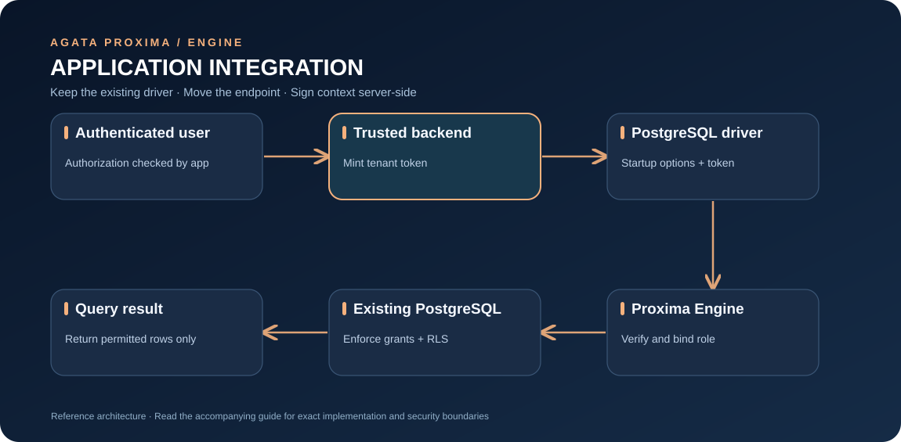

# Driver integration recipes

Proxima speaks the PostgreSQL wire protocol. Keep the driver you already use and point it at the Engine's host and port. If tenant enforcement is enabled, a trusted server must generate a valid tenant token and pass it during connection startup.

The examples below use local addresses and `sslmode=disable` for development only. Use validated TLS in production.

## Connection flow



[Open full-size diagram](assets/integrations.svg)

Keep tenant-token signing keys on trusted server-side components. Never generate tenant tokens in browser code or ship signing secrets to clients.

## psql

```bash
PGPASSWORD="$TENANT_DATABASE_PASSWORD" \
PGOPTIONS="-c proxima_tenant_token=$TENANT_TOKEN" \
psql "host=127.0.0.1 port=6432 dbname=appdb user=proxima sslmode=disable" \
  -c "SELECT current_user, current_database();"
```

The client username is the proxy login name. The Engine rewrites the upstream PostgreSQL username to the role derived from the signed tenant ID. The password must authenticate as that upstream tenant role.

## Node.js — node-postgres (`pg`)

Install the PostgreSQL driver in your application:

```bash
npm install pg
```

Example server-side connection:

```javascript
import pg from "pg";

const { Client } = pg;

// Obtain these values from trusted server-side configuration.
// Generate the token only after checking the signed-in user's tenant access.
const tenantToken = process.env.PROXIMA_TENANT_TOKEN;
if (!tenantToken) throw new Error("PROXIMA_TENANT_TOKEN is required");
const client = new Client({
  host: process.env.PROXIMA_HOST ?? "127.0.0.1",
  port: Number(process.env.PROXIMA_PORT ?? 6432),
  database: process.env.PG_DATABASE ?? "appdb",
  user: process.env.PROXIMA_LOGIN ?? "proxima",
  password: process.env.TENANT_DATABASE_PASSWORD,
  options: `-c proxima_tenant_token=${tenantToken}`,
  // For local-only development. Configure verified TLS in production.
  ssl: false,
});

await client.connect();
try {
  const result = await client.query("SELECT current_user, current_database()");
  console.log(result.rows[0]);
} finally {
  await client.end();
}
```

Do not embed the tenant signing key in this application client or browser bundle. Only a trusted backend should mint the token.

## Python — Psycopg 3

Install Psycopg:

```bash
python -m pip install "psycopg[binary]"
```

```python
import os
import psycopg

# Supply this only from a trusted backend after tenant authorization.
tenant_token = os.environ["PROXIMA_TENANT_TOKEN"]
with psycopg.connect(
    host=os.getenv("PROXIMA_HOST", "127.0.0.1"),
    port=int(os.getenv("PROXIMA_PORT", "6432")),
    dbname=os.getenv("PG_DATABASE", "appdb"),
    user=os.getenv("PROXIMA_LOGIN", "proxima"),
    password=os.environ["TENANT_DATABASE_PASSWORD"],
    options=f"-c proxima_tenant_token={tenant_token}",
    sslmode="disable",  # local development only
) as conn:
    print(conn.execute("SELECT current_user, current_database()").fetchone())
```

## Rust — tokio-postgres

Add `tokio-postgres` and `tokio` to your application dependencies. This example uses `NoTls` only for local development:

```rust
use tokio_postgres::{config::SslMode, NoTls};

#[tokio::main]
async fn main() -> Result<(), Box<dyn std::error::Error>> {
    let tenant_database_password = std::env::var("TENANT_DATABASE_PASSWORD")?;
    let tenant_token = std::env::var("PROXIMA_TENANT_TOKEN")?;

    let mut config = tokio_postgres::Config::new();
    config
        .host("127.0.0.1")
        .port(6432)
        .dbname("appdb")
        .user("proxima")
        .password(tenant_database_password)
        .ssl_mode(SslMode::Disable)
        .options(format!("-c proxima_tenant_token={tenant_token}"));

    let (client, connection) = config.connect(NoTls).await?;
    tokio::spawn(async move {
        if let Err(error) = connection.await {
            eprintln!("PostgreSQL connection error: {error}");
        }
    });
    let row = client.query_one("SELECT current_database()", &[]).await?;
    let database: String = row.get(0);
    println!("{database}");
    Ok(())
}
```

## Connection pool notes

- Mint or refresh tenant tokens on the trusted server side.
- A token is checked when a physical PostgreSQL connection starts. Do not assume a pool will automatically refresh a token for new connections.
- Avoid sharing one physical connection across different tenant identities. Use tenant-aware pool separation or create connections with the appropriate signed context.
- Set pool size and timeouts for the Engine's configured connection limit.
- Do not route production traffic directly to PostgreSQL as a way around the Engine.

## Is there an official SDK?

This repository provides the Engine and PostgreSQL connection contract; it does not publish a standalone npm, Python, or Rust Proxima SDK. The examples use existing PostgreSQL drivers and avoid suggesting that an unpublished package exists.


## Integration checklist

Before moving a driver example into a real service:

1. Use the database driver and runtime versions supported by your application; these recipes illustrate connection shape, not a universal compatibility guarantee.
2. Keep the connection string and credentials server-side. Never ship the tenant signing key to a browser, mobile app, or public client bundle.
3. Authenticate the caller and authorize the tenant in trusted application code before issuing a short-lived signed tenant token.
4. Configure the Engine's PostgreSQL endpoint, not the upstream database endpoint, for application traffic intended to traverse the proxy.
5. Test the selected database role and RLS policy with at least two synthetic tenants, including a query that must return no cross-tenant rows.
6. Configure connection timeouts, pooling, retries, and TLS verification deliberately; do not assume the proxy removes the need for application-level resilience.
7. Ensure application logs redact passwords, tokens, and tenant-sensitive query values.

## Common integration mistakes

- **Connection succeeds, but the wrong rows are visible:** review the token tenant ID, database role mapping, and RLS policy.
- **Token validation fails:** check the documented token format, expiry, signing secret, and system clock; do not disable enforcement to make a test pass.
- **Local example works, deployment fails:** verify DNS, firewall rules, TLS trust, container networking, and effective environment variables from the Engine runtime.
- **Looking for an SDK package:** this repository documents existing PostgreSQL drivers and does not claim a separately published Proxima SDK.
