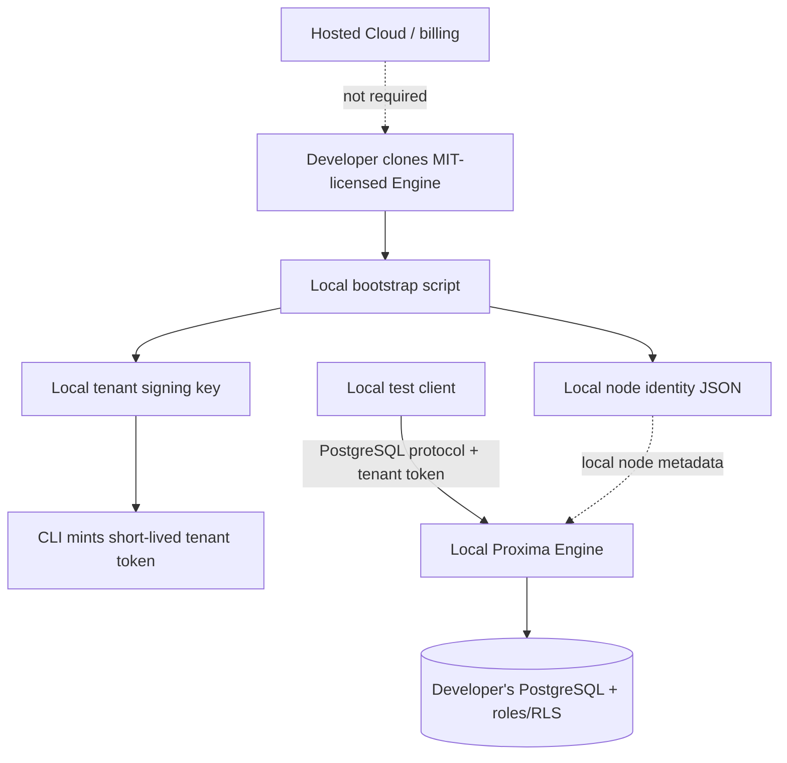

# Local developer mode: no hosted account required

This guide is the self-managed path for contributors and developers evaluating the open-source Engine. It does not call Agata Proxima Cloud, create a hosted API key, or require a paid account.

**What you get locally:** a generated node identity, a local tenant-signing secret, a command to mint signed test tenant-context tokens, and a repeatable way to test the Engine against your own disposable PostgreSQL instance. These are local development credentials, not Cloud API keys and not credentials accepted by the hosted service.

## The local trust boundary



The local identity is self-issued and only meaningful to your local environment. It does not register a host in Agata Proxima Cloud, and it cannot authenticate to a hosted management API. This separation is intentional: local core-engine development is free and independent; hosted organization management remains a separate service.

## 1. Clone and start the local demo

Requirements: Git, Python 3.10+ (for the standard-library bootstrap script), and Docker Compose.

```bash
git clone https://github.com/Agata-Proxima/proxima-engine.git
cd proxima-engine
docker compose -f compose.dev.yaml up --build -d
```

This first demo uses the default local PostgreSQL credentials and leaves tenant enforcement disabled so you can confirm basic connectivity. Follow [Quickstart](QUICKSTART.md) to run a real SQL query before continuing.

## 2. Generate local node identity and signing credentials

Run from the repository root:

```bash
python scripts/dev-bootstrap.py init
```

PowerShell uses the same command if Python is available as `python`. The command creates `.proxima-dev/dev-config.json` and `.proxima-dev/node-identity.json`. The files contain generated secrets and are private local artifacts. The script adds `.proxima-dev/` to the repository-root `.gitignore` without replacing existing ignore rules; do not commit generated credentials.

The bootstrap is offline. It uses Python's cryptographic random generator and UUID library, and makes no network request.

## 3. Mint a local tenant-context token

```bash
python scripts/dev-bootstrap.py token --tenant tenant_a --ttl 300
```

Copy the printed token into your local test client environment as `PROXIMA_TENANT_TOKEN`. The token expires after five minutes. To mint a token for a second test tenant:

```bash
python scripts/dev-bootstrap.py token --tenant tenant_b --ttl 300
```

The CLI signs the documented Engine format `v1.<tenant_id>.<expiry_unix_seconds>.<hex_hmac_sha256>` with the same local tenant-signing key stored in the generated config. The Engine must be configured with that exact value as `PROXIMA_TENANT_SIGNING_KEY` for token enforcement to be enabled. The script does not automatically configure an already-running container.

### Set the key for a native Engine process

PowerShell (run from the repository root):

```powershell
$config = Get-Content .proxima-dev/dev-config.json -Raw | ConvertFrom-Json
$env:PROXIMA_TENANT_SIGNING_KEY = $config.tenant_signing_key
$env:PROXIMA_NODE_ID = $config.node_id
$env:PROXIMA_ORGANIZATION_ID = $config.organization_id
$env:PROXIMA_NODE_SIGNING_KEY_HEX = $config.node_signing_key_hex
$env:PROXIMA_NODE_IDENTITY_PATH = (Resolve-Path .proxima-dev/node-identity.json).Path
$env:PROXIMA_LISTEN_ADDR = "127.0.0.1:6432"
$env:PROXIMA_UPSTREAM_ADDR = "127.0.0.1:5432"
cargo run -p proxima-engine
```

Bash:

```bash
export PROXIMA_TENANT_SIGNING_KEY="$(python -c 'import json; print(json.load(open(".proxima-dev/dev-config.json"))["tenant_signing_key"])')"
export PROXIMA_NODE_ID="$(python -c 'import json; print(json.load(open(".proxima-dev/dev-config.json"))["node_id"])')"
export PROXIMA_ORGANIZATION_ID=local-dev
export PROXIMA_NODE_SIGNING_KEY_HEX="$(python -c 'import json; print(json.load(open(".proxima-dev/dev-config.json"))["node_signing_key_hex"])')"
export PROXIMA_NODE_IDENTITY_PATH="$PWD/.proxima-dev/node-identity.json"
export PROXIMA_LISTEN_ADDR=127.0.0.1:6432
export PROXIMA_UPSTREAM_ADDR=127.0.0.1:5432
cargo run -p proxima-engine
```

Use either the native run or the Compose demo, not both on the same ports. For Compose, set `PROXIMA_TENANT_SIGNING_KEY` in the shell before recreating the Engine container. See [Configuration](CONFIGURATION.md).

## 4. Test tenant routing with PostgreSQL roles and RLS

A signed token is only one part of tenant isolation. PostgreSQL must contain matching least-privilege roles and RLS policies. Follow the complete runnable SQL and positive/negative tests in [Tenant isolation](TENANT_ISOLATION.md). Do not point that destructive tutorial at a database containing valuable data.

Example client connection shape:

```bash
PGPASSWORD='tenant-a-password' \
PGOPTIONS="-c proxima_tenant_token=$PROXIMA_TENANT_TOKEN" \
psql "host=127.0.0.1 port=6432 dbname=appdb user=proxima sslmode=disable" \
  -c "SELECT tenant_id, secret FROM tenant_demo.records;"
```

For Node.js, Python, and Rust driver examples, see [Integration recipes](INTEGRATIONS.md).

## 5. What is and isn't an API key?

The public Engine is a PostgreSQL wire-protocol proxy plus local health/status/metrics endpoints. It does not expose a general-purpose REST API or hosted API-key management endpoint. The bootstrap therefore generates **local node identity and tenant-context signing credentials**, not a universal HTTP API key. Tenant tokens are short-lived signed context assertions used during PostgreSQL connection startup; they are not user authentication, subscription keys, or hosted credentials.

You do not need a Cloud account to clone, build, run, test, generate local credentials, or experiment with your own local node identity. A local identity does not create a hosted registered node. If you specifically need the hosted dashboard to recognize a node, that is a different workflow and requires the hosted service.

## 6. Reset local developer credentials

Stop the Engine first, then delete the generated directory.

Bash:

```bash
rm -rf .proxima-dev
```

PowerShell:

```powershell
Remove-Item .proxima-dev -Recurse -Force
```

This permanently deletes the local identity and signing secret. Generate a new identity with the `init` command when needed.

## Security rules

- Use synthetic data and disposable PostgreSQL databases only.
- Never commit `.proxima-dev/`, its config, node identity, signing key, or generated tokens.
- Do not reuse these local credentials in production or with Agata Proxima Cloud.
- Keep tenant-token signing keys on trusted server-side processes; never ship them in a browser or mobile bundle.
- A successful local run is not proof of tenant isolation. Run both permitted and denied RLS tests.
- Keep health, status, and metrics listeners on loopback or a restricted private network.
