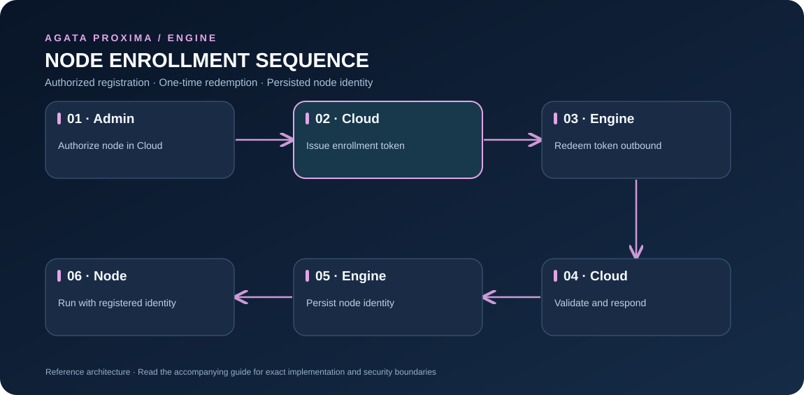

# Node identity and enrollment

This guide covers the Engine side of node registration: the environment variables to set, how the one-time token is consumed, where the identity is stored, and how to troubleshoot startup failures.

## Understand the boundary



[Open full-size diagram](assets/node-enrollment.svg)

The diagram describes the intended integration sequence. Actual account authorization and token issuance happen in the hosted product; this public repository covers Engine-side configuration and persistence, not private dashboard endpoints.

## Local-only development versus hosted enrollment

For a completely offline local identity and signed test-token workflow, start with [Local developer mode](LOCAL_DEVELOPMENT.md). It generates a local node identity and test tenant credentials without a Cloud account. That identity is self-issued and does not register a node with Agata Proxima Cloud.

The Engine can run locally without any node registration. To give an Engine instance a registered identity, a compatible Agata Proxima control plane must issue a node UUID and a short-lived, one-time enrollment token. The control plane owns node creation and token issuance; this repository does not implement a node-creation REST endpoint.

This guide documents the public Engine contract. It does not reproduce the hosted management application or its private API.

## 1. Obtain enrollment values

For hosted usage, start at [agataproxima.com](https://agataproxima.com) and use your authorized account workflow to obtain the enrollment values. The hosted management workflow and its private API are not distributed in this repository. For a self-managed setup, use your own compatible control plane.

Obtain:
- The registered node UUID.
- The HTTPS enrollment URL ending in `/api/v1/nodes/enroll`.
- The one-time enrollment token.

The token is a secret. Copy it once into a protected terminal or secret store. Do not paste it into GitHub, screenshots, chat, logs, or an image.

For local development only, an enrollment endpoint may use loopback HTTP. Use HTTPS for any remote host.

## 2. Configure the Engine (PowerShell)

Replace the placeholders with values issued for your node:

```powershell
$env:PROXIMA_NODE_ID = "<node-uuid>"
$env:PROXIMA_NODE_ENROLLMENT_URL = "https://<control-plane-host>/api/v1/nodes/enroll"
$env:PROXIMA_NODE_ENROLLMENT_TOKEN = "<one-time-token>"

$env:PROXIMA_LISTEN_ADDR = "127.0.0.1:6432"
$env:PROXIMA_UPSTREAM_ADDR = "127.0.0.1:5432"

cargo run -p proxima-engine
```

The Engine sends `POST /api/v1/nodes/enroll` with JSON containing `node_id` and `enrollment_token`. The compatible control plane validates the token and returns the node identity and signing credential. The Engine validates the returned identity and writes it to disk.

After successful enrollment, remove the one-time token from that terminal:

```powershell
Remove-Item Env:PROXIMA_NODE_ENROLLMENT_TOKEN -ErrorAction SilentlyContinue
```

## 3. Configure the Engine (Bash)

```bash
export PROXIMA_NODE_ID="<node-uuid>"
export PROXIMA_NODE_ENROLLMENT_URL="https://<control-plane-host>/api/v1/nodes/enroll"
export PROXIMA_NODE_ENROLLMENT_TOKEN="<one-time-token>"
export PROXIMA_LISTEN_ADDR="127.0.0.1:6432"
export PROXIMA_UPSTREAM_ADDR="127.0.0.1:5432"
cargo run -p proxima-engine
unset PROXIMA_NODE_ENROLLMENT_TOKEN
```

Set these variables in the same process environment that starts the Engine. The Engine does not assume a plain `.env` file is automatically loaded.

## 4. Protect and persist the identity

The default identity path is:
- Windows: `%LOCALAPPDATA%\AgataProxima\node-identity.json`, when `LOCALAPPDATA` exists.
- Other environments: `data/node-identity.json`.

Override it with `PROXIMA_NODE_IDENTITY_PATH`. The identity file contains the node ID, organization ID, and a 32-byte signing credential. Restrict file permissions and back it up securely. The Engine reuses a valid existing identity on later starts, so the one-time token is not needed each time.

To enroll a different node on the same machine, use a different identity path. Do not overwrite an identity that is still in use.

## 5. Understand the different secrets

| Variable or file | Purpose | Handling |
| --- | --- | --- |
| `PROXIMA_NODE_ENROLLMENT_TOKEN` | One-time bootstrap credential | Short-lived; consumed once; remove after enrollment |
| `PROXIMA_NODE_IDENTITY_PATH` | Persistent identity file path | Contains a signing credential; treat as a secret |
| `PROXIMA_NODE_SIGNING_KEY_HEX` | 32-byte node signing key, hex encoded | Normally loaded from the identity file; never commit |
| `PROXIMA_TENANT_SIGNING_KEY` | HMAC key for application-signed tenant context | Separate from node credentials; at least 32 bytes |
| `PROXIMA_ATTESTATION_INGEST_TOKEN` | Optional bearer credential for a compatible evidence receiver | Must use the expected `aga_` token prefix; never commit |

These values are not interchangeable. In particular, do not use the enrollment encryption key or tenant-context signing key as a node signing key.

## Troubleshooting

- **401 Unauthorized:** check that the node UUID and token belong together, the token has not expired or been consumed, and the control plane URL is correct. Obtain a new token through your authorized control-plane workflow.
- **Connection refused / timeout:** check DNS, routing, firewall rules, and that the enrollment service is listening at the configured URL.
- **TLS certificate error:** use the correct HTTPS hostname and a trusted certificate. Do not disable certificate verification.
- **Identity file error:** check the file path, JSON validity, and read/write permissions. Choose a separate path for a new node.
- **Engine exits before listening:** read the startup error first; enrollment errors are fatal when enrollment variables are supplied but cannot be validated.

A local successful build does not verify that a remote control plane, its credentials, or your network path is configured correctly.
