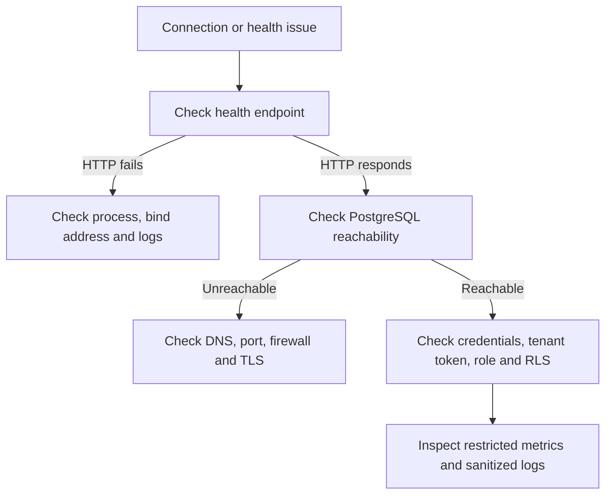

# Proxima Engine operations and troubleshooting

Use this guide to diagnose the Engine process, PostgreSQL connectivity, tenant authentication, observability, and persistent local state.

## First-response flow



## Health and status endpoints

Default local endpoints:

- Engine status page: `http://127.0.0.1:9080/`
- Status JSON: `http://127.0.0.1:9080/api/status`
- Status-page health: `http://127.0.0.1:9080/health`
- Metrics and health: `http://127.0.0.1:9090/metrics`, `/health`, and `/healthz`

The status page and metrics listener do not authenticate callers. Keep them on loopback or a restricted private network. A health response confirms the HTTP handler is responding; run a SQL query through port 6432 to verify the PostgreSQL protocol path.

## Inspect local Compose logs

```bash
docker compose -f compose.dev.yaml ps
docker compose -f compose.dev.yaml logs --tail=200 engine
docker compose -f compose.dev.yaml logs --tail=100 pgbouncer
docker compose -f compose.dev.yaml logs --tail=100 postgres
```

For a native process, inspect the startup terminal for configuration errors, upstream connection failures, TLS errors, and enrollment failures. Redact tokens, passwords, private keys, and customer data before sharing logs.

## Common failures

| Symptom | Likely cause | What to check |
|---|---|---|
| Engine exits on startup | Invalid environment value or incomplete TLS configuration | First startup error and [Configuration](CONFIGURATION.md) |
| Connection refused on 6432 | Engine is stopped or bound to another address | Process/container health and `PROXIMA_LISTEN_ADDR` |
| Upstream connection error | PostgreSQL or PgBouncer is unavailable to the Engine | `PROXIMA_UPSTREAM_ADDR`, DNS, firewall, and upstream logs |
| Tenant token required | Tenant enforcement is active | Send a valid signed token in PostgreSQL startup options |
| Invalid or expired tenant token | Wrong signing key, token signature, tenant ID, or expiry | Use the configured key and mint a fresh short-lived token |
| PostgreSQL permission denied | Tenant role password, grants, or RLS policy mismatch | Confirm the derived role and inspect PostgreSQL grants/policies |
| TLS handshake failure | Certificate/key, CA, or server-name mismatch | Check client and upstream TLS configuration |
| Enrollment returns 401 | Token expired, consumed, or paired with another node ID | Issue a fresh one-time token through the compatible control plane |
| Status endpoint returns 404 | Wrong path or listener | Use the routes in [API reference](API.md) |
| No attestation records | Attestation settings or signing credential are incomplete | Check the signing key, `PROXIMA_ATTESTATION_P99_OVERHEAD_MS`, and ledger path |

## Persistence and restart

The Engine stores attestation records, node identity, and emergency-token replay markers on disk. In containers, mount a persistent restricted volume at `/var/lib/proxima`. Preserve that volume during ordinary restarts.

The local Compose profile stores PostgreSQL data in a named volume:

- `docker compose -f compose.dev.yaml down` stops and removes containers while retaining volumes.
- `docker compose -f compose.dev.yaml down -v` also deletes the local database and Engine volumes.

## Monitoring practices

- Scrape Prometheus metrics from a private monitoring network.
- Alert on repeated session failures, rejected connections, connection saturation, upstream errors, and stale evidence delivery.
- Treat process-local counters as telemetry; they reset on restart and are not a durable audit record.
- Protect and back up the attestation ledger and node identity file.
- Test restore, certificate rotation, secret rotation, upstream outages, and planned restarts.

## Symptom-to-check guide

| Symptom | Check first | Avoid |
|---|---|---|
| Health endpoint unavailable | Process state, bind address, port mapping, container logs | Exposing the listener to every network as a quick fix |
| Health is green but SQL fails | Upstream reachability, database name, credentials, TLS mode, protocol listener | Treating HTTP health as a successful database query |
| SQL works but tenant rows are wrong | Token issuer, tenant ID, selected database role, RLS policies | Granting superuser or RLS-bypass privileges to application roles |
| Enrollment rejected | Token expiry, node ID, control-plane configuration, outbound network | Reusing or publishing one-time enrollment tokens |
| Metrics missing | Metrics listener, scrape target, network policy, scrape errors | Publishing unauthenticated metrics on a public interface |
| Attestation or break-glass verification fails | Verifier options, trusted key, organization/node context, expiry, clock | Disabling verification without an approved incident procedure |

## Incident response

1. Protect users first: isolate the affected path or pause sensitive traffic if tenant separation is uncertain.
2. Preserve sanitized logs and the exact Engine commit/image digest.
3. Keep live secrets and customer data out of issues, chat, and email.
4. Reproduce with synthetic tenants and a disposable database.
5. Rotate credentials through the established secret-management process and coordinate dependent services.
6. Validate recovery with successful and denied tenant requests before restoring traffic.
7. Record cause, impact, mitigation, and follow-up tests.

Counters and process metrics are operational telemetry. Use the attestation ledger and its verification procedure for signed evidence, and protect the ledger, signing credential, host, and backups.
