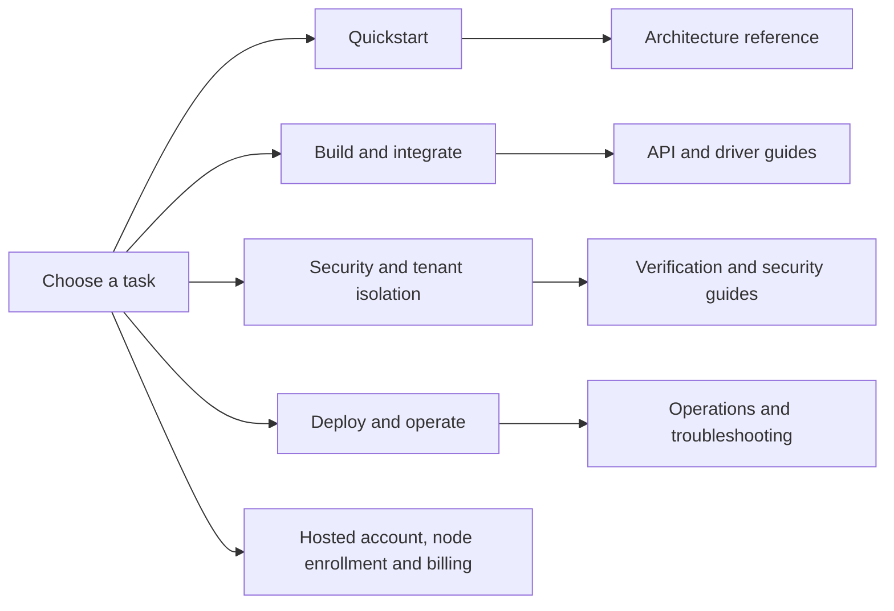

# Proxima Engine documentation

Choose a task and go directly to the guide. This repository contains the public Rust Engine and its local operating tools.

## Start here

- **[Quickstart](QUICKSTART.md)** — start PostgreSQL and Proxima, run a real SQL query through the proxy, and inspect health/metrics.
- **[What is Proxima? Architecture](ARCHITECTURE.md)** — purpose, request flow, source map, and trust boundaries.
- **[Tenant isolation tutorial](TENANT_ISOLATION.md)** — create PostgreSQL roles, apply RLS, sign a test tenant token, and verify allowed/denied queries.
- **[Node identity and enrollment](NODE_ENROLLMENT.md)** — copy/paste the Engine environment, one-time token flow, identity persistence, and 401 troubleshooting.

## Build and operate

- [Configuration reference](CONFIGURATION.md) — all supported environment variables, defaults, and validation.
- [API, health, and metrics](API.md) — actual local HTTP routes, PostgreSQL connection contract, metrics, and enrollment boundary.
- [Driver integration recipes](INTEGRATIONS.md) — psql, Node.js, Python, and Rust examples.
- [Container deployment](DEPLOYMENT.md) — Docker build, upstream configuration, TLS, persistence, and production checklist.
- [Verification and CLI tools](VERIFICATION.md) — automated tests, PostgreSQL integration tests, attestation verification, and break-glass token tool.
- [Audit evidence and external exports](AUDIT_EVIDENCE_AND_EXPORTS.md) — architecture diagram and the boundary between Engine evidence and hosted audit exports.
- [Security model and limitations](SECURITY.md) — threat boundaries and safe deployment.
- [Operations and troubleshooting](OPERATIONS.md) — health checks, metrics, common failures, and shutdown/recovery.

## Hosted product and support

## Hosted product and support

- [Cloud control-plane boundary](CLOUD_CONTROL_PLANE.md) — hosted workflow versus self-managed Engine.
- [Plans and billing](BILLING.md) — how to verify current plan limits and upgrade safely.
- [Support and troubleshooting](SUPPORT.md) — contact routes, diagnostics, and what not to share.

## Contribute and govern

- [Contributing](../CONTRIBUTING.md) — development setup, tests, and pull request requirements.
- [Security reporting](../SECURITY.md) — private vulnerability disclosure guidance.
- [Code of Conduct](../CODE_OF_CONDUCT.md) — community expectations.
- [Copyright, license, and trademarks](../COPYRIGHT.md) — license scope for this repository.
- [MIT License](../LICENSE) — terms for covered source and documentation.
- [GitHub Issues](https://github.com/Agata-Proxima/proxima-engine/issues) · [Pull requests](https://github.com/Agata-Proxima/proxima-engine/pulls) · [Releases](https://github.com/Agata-Proxima/proxima-engine/releases) · [CI](https://github.com/Agata-Proxima/proxima-engine/actions)

## Scope

The Engine is independently buildable and testable. A separate compatible control plane may issue node enrollment tokens and receive optional signed evidence, but its management endpoints are not served by this Engine. See the public [Agata Proxima website](https://agataproxima.com) for the separate hosted service.
