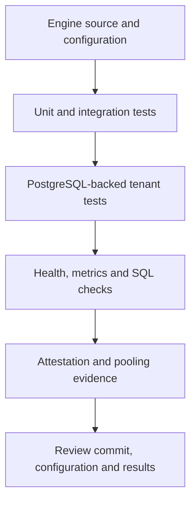

# Verification and test guide

Use this guide to run the Engine test suite, exercise the PostgreSQL integration path, inspect runtime endpoints, and verify signed local evidence. Record the exact source commit and toolchain with each result.

## Verification workflow



## 1. Run Rust tests and build the release binary

```bash
cargo test -p proxima-engine
cargo build -p proxima-engine --release
```

The PostgreSQL-backed integration test connects to a local PostgreSQL service at `127.0.0.1:5432` using:

- Database: `proxima_dev`
- User: `proxima`
- Password: `proxima-dev-only`

Start a disposable PostgreSQL 17 instance:

```bash
docker run --rm --name proxima-ci-postgres \
  -e POSTGRES_USER=proxima \
  -e POSTGRES_PASSWORD=proxima-dev-only \
  -e POSTGRES_DB=proxima_dev \
  -p 127.0.0.1:5432:5432 postgres:17
```

Keep it running in one terminal, then run the Rust test command in another. The integration test creates the `proxima_e2e` schema and tenant roles in that database. Use a disposable instance because the test drops and recreates its test schema.

GitHub Actions provisions the PostgreSQL service automatically.

## 2. Run the two-tenant acceptance test

The CI workflow also runs:

```bash
bash scripts/test-two-tenants.sh
```

This acceptance script creates two non-superuser tenant roles, enables RLS, starts the Engine with tenant-token enforcement, and checks:

- Tenant A sees only Tenant A's record.
- Tenant B sees only Tenant B's record.
- Tenant A's cross-tenant read returns zero rows.
- Tenant A's cross-tenant write is rejected.
- An invalid tenant token is rejected.

The script operates on the disposable CI PostgreSQL service configured by the workflow. Use a disposable local database with the same credentials when running it manually.

## 3. Verify the local HTTP surfaces

With the [Quickstart](QUICKSTART.md) stack running:

```bash
curl -fsS http://127.0.0.1:9090/healthz
curl -fsS http://127.0.0.1:9080/api/status
curl -fsS http://127.0.0.1:9090/metrics
```

Then run a SQL query through port 6432. Health confirms that the HTTP handler responds; the SQL query exercises the PostgreSQL protocol path.

## 4. Review PgBouncer transaction-pooling evidence

The repository includes [recorded PgBouncer evidence](../evidence/pgbouncer-transaction-pooling.txt) for PgBouncer 1.24.1 and PostgreSQL 17.

The record shows five sequential client connections per tenant, backend PID reuse within each tenant role, distinct PostgreSQL roles, and separate backend PIDs between Tenant A and Tenant B. It also records tenant-specific reads and denied cross-tenant reads/writes.

The evidence file is a recorded local test result. The standard GitHub Actions workflow runs the Rust/PostgreSQL suite and the two-tenant acceptance script; it does not currently launch PgBouncer as a CI service.

## 5. Verify an attestation ledger

The verifier checks the local hash-linked ledger and validates its signatures. Supply the same signing key, organization ID, and node ID used when records were created. The CLI reads the configured ledger path; it does not automatically extract credentials from the Engine identity JSON file.

```bash
export PROXIMA_ATTESTATION_LEDGER_PATH=data/proxima-attestations.jsonl
export PROXIMA_ORGANIZATION_ID='<recorded-organization-id>'
export PROXIMA_NODE_ID='<recorded-node-id>'
export PROXIMA_NODE_SIGNING_KEY_HEX='<64-hex-character-node-key>'
cargo run -p proxima-engine --bin proxima-attest-verify
```

- Exit code 0: one or more records were present and the chain verified.
- Exit code 2: no records exist or the chain is invalid.
- Exit code 1: the ledger could not be read or verification encountered an I/O/runtime error.

Configure the signing credential and required attestation settings before expecting records. See [Configuration](CONFIGURATION.md).

## 6. Generate an emergency token

The command-line tool issues a short-lived signed break-glass token for a tenant:

```bash
export PROXIMA_TENANT_SIGNING_KEY='<local-test-secret-at-least-32-bytes>'
cargo run -p proxima-engine --bin proxima-break-glass-token -- tenant_a 300
```

The maximum lifetime is 900 seconds (15 minutes). The Engine records used nonces in its replay directory and rejects token reuse. Keep generated tokens private and out of logs.

## 7. CI workflow

The [Rust CI workflow](https://github.com/Agata-Proxima/proxima-engine/actions/workflows/ci.yml) runs on pushes to `main` and pull requests targeting `main`. It provisions PostgreSQL 17, runs the Python CLI tests, executes `cargo test -p proxima-engine`, builds the release binary, runs the two-tenant acceptance script, and builds the Docker image.

A green workflow run is direct evidence that those configured checks passed for its commit. For deployment acceptance, also verify the target environment's TLS, database roles/RLS, network policy, persistence, and recovery procedures.

## Evidence record

For each verification run, record:

- Exact Git commit SHA and container image digest, when applicable.
- Operating system, CPU architecture, Rust toolchain, and container runtime versions.
- Test commands, exit status, and relevant output.
- PostgreSQL version and whether the database was disposable.
- Positive tenant access and denied cross-tenant access results.
- TLS validation and connection behavior for the target environment.
- Attestation verifier command, trusted key fingerprint, organization/node context, and result.

Never include private keys, passwords, signed tokens, or customer data in published evidence.
